# How the 3D view renders the atmosphere

The interactive map's **3D view** draws a weather model's fields through the depth of the
atmosphere: clouds, moisture, wind, temperature and the rest, in a box over the map from the
ground to 12 km. This document explains the whole path, from the model files to the pixels on
screen:

1. [Building the volumes](#1-building-the-volumes): `briefing/volume.py` turns pressure-level
   GRIB into small byte grids.
2. [Loading them in the page](#2-loading-them-in-the-page): unpacking, plus the fields worked out
   in the browser.
3. [The box](#3-the-box): how the grid sits over a Web Mercator map.
4. [Ray marching](#4-ray-marching): the fragment shader that draws the volume.
5. [Transfer tables and surfaces](#5-transfer-tables-and-surfaces): what each value looks like.
6. [Render modes](#6-render-modes): Volume, Cloud, Max, Solid, Points and Scan.
7. [Lighting and shadows](#7-lighting-and-shadows).
8. [Caching and frame flow](#8-caching-and-frame-flow): why it stays fast enough.
9. [Everything else in the box](#9-everything-else-in-the-box): particles, falling precipitation,
   level maps, trajectories, the cross-section and terrain.
10. [Adding a field](#10-adding-a-field), and [where the code lives](#11-where-the-code-lives).

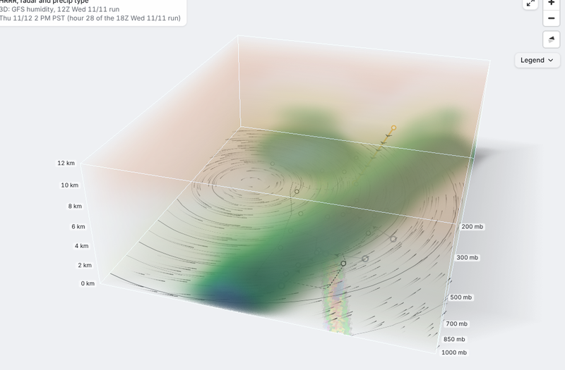

---

## 1. Building the volumes

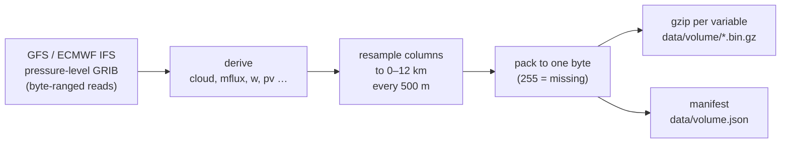

`python -m briefing.volume` runs in its own workflow after the briefing publishes, so the edition
never waits for it. For every model with `volume:` in `config.yaml` (GFS and ECMWF IFS; HRRR has no
volume), it reads every `step` hours (3) over the first `hours` (48) of the briefing:

| | Levels read (hPa) |
|---|---|
| GFS | 1000, 950, 900, 850, 800, 750, 700, 600, 500, 400, 300, 250, 200 |
| ECMWF IFS | 1000, 925, 850, 700, 600, 500, 400, 300, 250, 200 |

From these it derives the variables the page draws:

| Variable | Units | Packing | Notes |
|---|---|---|---|
| `temp` | °F | linear −80 … 90 | |
| `wind` | mph | linear 0 … 200 | `u`, `v` (m/s) too, for particles and trajectories |
| `rh` | % | linear | |
| `cloud` | % | linear | GFS's own; ECMWF has none on levels, so it's estimated from RH (Sundqvist, above 80%) |
| `water`, `ice` | g/kg | **sqrt** 0 … 2 | GFS only: cloud water + rain; ice + snow + graupel |
| `mflux` | (g/kg)(m/s) | **sqrt** 0 … 500 | specific humidity × wind speed: an atmospheric river's plume |
| `w` | m/s | linear −2 … 2 | rising (+) and sinking (−); ECMWF's ω converted with the air density |
| `pv` | PVU | linear −2 … 10 | Ertel's potential vorticity; 2 PVU is the dynamic tropopause |
| `hgt` | m | linear ±900 | each pressure level's height as a departure from its mean, **per level** not per height |

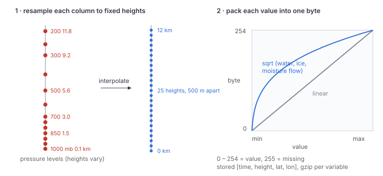

**Resampling.** Pressure levels sit at different heights in every column (lower in cold air,
higher in warm), so each column is interpolated linearly in height onto a fixed grid: 0 to 12 km
every 500 m, which gives 25 heights (`to_heights`). The levels' own geopotential heights do the
mapping. Below a column's lowest level, the value is held at that level's value. The fixed grid
lets the page draw to scale, and makes a height a texture coordinate.

**Packing.** Each value becomes one byte: 0 – 254 across the variable's range, and 255 for
missing. Water, ice and moisture flow are spread on a square-root scale because they span orders
of magnitude: a byte step near zero is a much smaller amount than one near the top, so thin cloud
keeps detail. The file for one model and variable holds every time step, laid out
`[time, height, lat (south → north), lon (west → east)]`, gzip-compressed. Two models run to a
few megabytes in total.

**The manifest** (`data/volume.json`) lists each model's grid (`nx`, `ny`, `nz`, lat/lon of the
edge cells, `topKm`, `dzKm`), its times, its pressure levels' mean heights (for the axis labels),
and each variable's path, range, scale, units and label. The page reads ranges from the manifest,
so a range can change without touching the front end.

## 2. Loading them in the page

`lib/volume.ts`:

- `useVolumes(on)` fetches the manifest the first time 3D is turned on.
- `loadVolume(v)` fetches a variable's `.bin.gz`, unzips it with the browser's
  `DecompressionStream("gzip")`, and caches the resulting `Uint8Array` by path, so switching
  fields back and forth costs nothing the second time.
- `unpack(byte, v)` reverses the packing: `x = b/254`, squared for sqrt variables, then scaled to
  `min … max`.

**Fields worked out in the page.** Seven views aren't in the files. `viewVar` builds them from
fields that are, and repacks the result on the same kind of byte scale. Each `DERIVED` entry
names its inputs and a rule. The rule gets the inputs unpacked (NaN where missing), each height's
pressure (log-interpolated between the model's levels at their mean heights), the cell spacing in
metres, and the terrain when it asks for it:

| View | From | Rule |
|---|---|---|
| Snow growth zone (`dgz`) | `rh`, `temp` | humidity where it's −12 to −18 °C (10 to 0 °F), eased in over 1.2 °F at each end |
| Icing (`icing`) | `water`, `temp` | liquid water colder than freezing, down to −20 °C (−4 °F) |
| Wet-bulb snow level (`wbz`) | `temp`, `rh` | wet-bulb temperature (Stull 2011), drawn as its 32 °F surface coloured by height |
| θe (`thetae`) | `temp`, `rh`, pressure | equivalent potential temperature (Bolton 1980), surfaces at 290 – 320 K |
| Isentropic surfaces (`theta`) | `temp`, pressure | potential temperature, surfaces at 290 – 320 K coloured by height; its solid is the air *below* the value, so the surface is its top |
| Orographic lift (`oro`) | `u`, `v`, terrain | wind · terrain slope on the model grid, × exp(−height above ground / 2 km) |
| Turbulence (`turb`) | `temp`, `u`, `v`, pressure | Richardson number N²/S² from centred differences over ±500 m, above 1.5 km; packed high to low (byte 0 is Ri 2) so missing and calm air are clear |

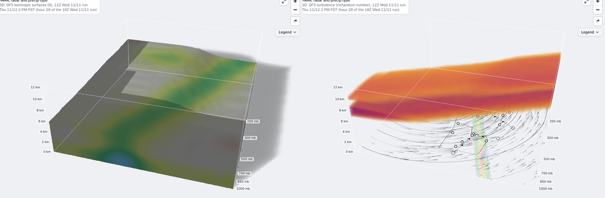

The terrain for orographic lift comes from the same Terrarium tiles as the map's elevation
(`elevationFor`), averaged over each model cell.

A derived view has a `make()` instead of a file, and a path like `derived/GFS/<run>/icing` that
only serves as the cache key. Anything that needs a view's encoding (the cross-section, the
legend, the profile) should go through `viewVar(entry, name)` and not `entry.vars[name]`, which
only holds the stored files. The freezing level (`frz`) has no data of its own: it's the
temperature field, drawn as just its 32 °F surface.

**Observed radar** (`lib/mrms3d.ts`) is the one volume that isn't a model. It shows up in the
3D panel's Model list as "MRMS radar (observed)", with a single field, reflectivity (`dbz`).
NOAA's MRMS publishes a 3D reflectivity mosaic, `MergedReflectivityQC`, at 33 heights from 0.5
to 19 km above sea level, every 2 minutes, in a public bucket the page can read directly. For
each frame:

- 21 levels are read: every 500 m from 0.5 to 9 km, plus 10, 11 and 12 km. That's about 10 MB.
- They're decoded in the MRMS workers (`decodeMrms`, the same code as the 2D composite), cropped
  to the models' box and reduced 4× to 0.04°. Each block keeps its strongest echo, so storm
  cores survive.
- They're packed onto the 3D view's heights: 9.5, 10.5 and 11.5 km are filled in from their
  neighbours, and 0.5 km is copied to the ground. Bytes run 0 – 75 dBZ, and no echo is 0, which
  draws as clear.

The frames offered are hourly over the last 6 hours of the briefing's window, plus every 10
minutes over the last hour. The list is refreshed every 10 minutes while the window reaches now.
Frames are only downloaded when the clock reaches them: the entry's variable has a `lazy`
loader, the page asks for the two steps either side of the clock, and when one arrives the layer
re-uploads that step's texture (`refreshStep`).

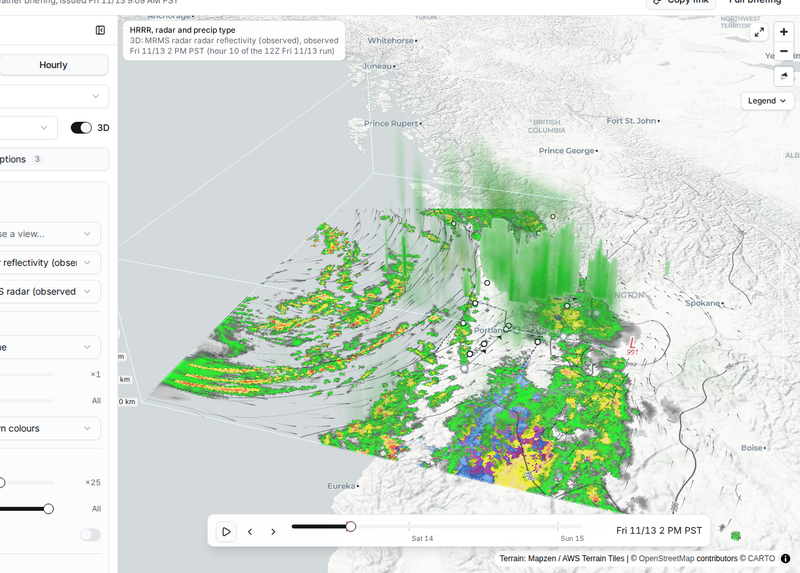

## 3. The box

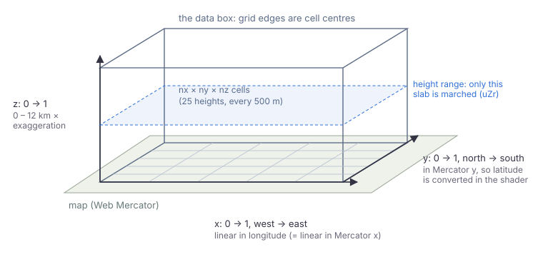

The volume is drawn in a box whose corners are the grid's edge cell centres. Everything in the
box, including the shader, the particles and the overlays, uses the same **box coordinates**, 0 to
1 on each axis:

- **x** runs west → east and is linear in longitude, which is also linear in Web Mercator x.
- **y** runs north → south in Web Mercator y, matching the map's own projection. The data's rows
  are evenly spaced in *latitude*, so the shader converts: `lat = atan(sinh(π(1 − 2·mercY)))`,
  then latitude → texture row. Without this, features would drift north or south of where they
  belong on the map, by up to half a cell at this size.
- **z** runs from the ground to `topKm` (12 km), multiplied by the **exaggeration** (the default
  makes the box readable; at 1× the atmosphere is a thin film 12 km thick over a box 1,000 km wide).

The model matrix maps the box to Web Mercator (`render()` in `volume-layer.ts`), and MapLibre's
camera matrix maps that to the screen. The layer also keeps the inverse (`uInv`, clip → box),
which the shader uses to turn each pixel into a ray.

The **height range** slider (`uZr`) clips the box to a slab: rays only march between its bottom
and top, and the slab gets its own outline.

## 4. Ray marching

`lib/gl/volume-layer.ts` is a MapLibre **custom layer**. Its fragment shader runs once per pixel
of a full-screen quad:

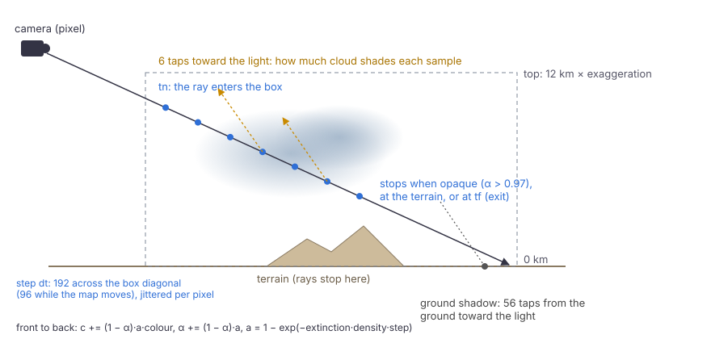

1. **Make a ray.** Unproject the pixel at the near and far clip planes through `uInv` to get the
   ray's origin and direction in box coordinates.
2. **Clip to the box.** Do a slab test against x ∈ [0, 1], y ∈ [0, 1] and z ∈ [zLo, zHi]. That
   gives the entry and exit distances `tn` and `tf`. A ray that misses the box is discarded,
   unless ground shadows are on.
3. **Step through it.** Size the steps so that 192 of them cross the box's diagonal (96 while the
   map is moving). The first sample is offset by a per-pixel hash, and that jitter turns
   wood-grain banding into fine noise.
4. **Sample.** Read the 3D texture for the two forecast steps either side of the clock, with
   hardware trilinear filtering, and blend them: `mix(A, B, uT)`. That byte indexes the field's
   **transfer table**, which gives a colour and an extinction.
5. **Composite front to back.** The opacity of each step follows its *true* length in the box,
   so a step's opacity doesn't change with the exaggeration or the camera angle:

   ```glsl
   float a = 1.0 - exp(-extinction * 4.0 * uDensity * worldStep);
   acc.rgb += (1.0 - acc.a) * a * colour;
   acc.a   += (1.0 - acc.a) * a;
   ```

6. **Stop early** once the pixel is nearly opaque (`acc.a > 0.97`), when the ray goes into the
   terrain, or at `tf`.

The fields live in **one R8 3D texture per time step** (`nx × ny × nz` bytes). Each is uploaded
the first time it's needed and kept, so scrubbing back over a step is free. Missing bytes (255)
become 0 on upload, which every transfer table draws as clear. Texture coordinates put the
cell centres on the box's faces: `(f · (size − 1) + 0.5) / size`.

Time blending is linear between the two steps, which are 3 hours apart. A front moving 100 km
in that time fades from one place to the next instead of sliding, which is honest about what the
data knows.

## 5. Transfer tables and surfaces

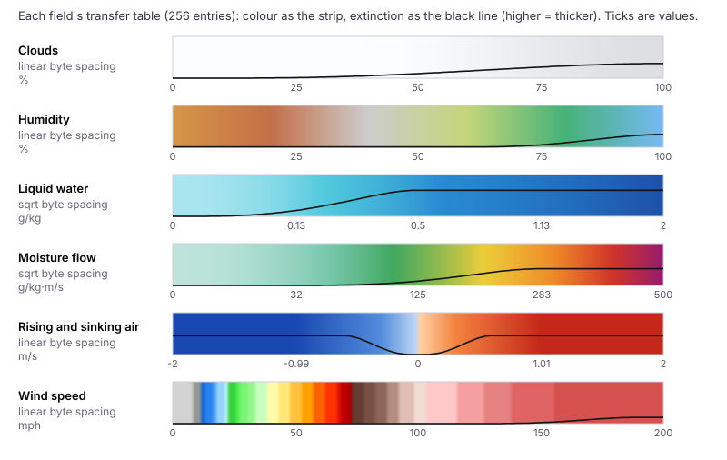

Each view has a **transfer function** (`transfer(name, value)` in `lib/volume.ts`). It returns
the colour, and the **extinction**, which is how thick the field looks at that value. `lutFor`
samples it at all 256 bytes into a 256 × 1 RGBA texture, with the extinction scaled into alpha as
`e / 4`. The black lines above show the extinction curves:

- Cloud, water and ice thicken with the amount.
- Humidity is a faint haze when dry, and fills in above about 55%.
- Moisture flow is invisible in dry or still air and thickens through an atmospheric river's
  core.
- Vertical motion uses a diverging scale and is clear where the air is still.
- Wind is nearly clear except for a haze in the jet core above about 120 mph.
- Temperature is the faintest wash, and PV is entirely clear: both read as surfaces instead.

**Surfaces (`ISOS`).** Temperature, wind, freezing level and PV are drawn as shells where the
field crosses set values (32 °F, 110 mph, 2 PVU and so on). Volume shading is soft by nature, so
these crossings are found exactly instead. When two consecutive samples straddle a value, the
crossing point is found by linear interpolation along the step. It's shaded by the field's
gradient (a central difference in the box's true proportions, which serves as the normal), and
composited at its own alpha *before* that step's volume. This keeps the surfaces crisp at any step
size. The freezing level and the tropopause take their colour from their **height**, through a
height table (`heightLut`), so you can read how high they are.

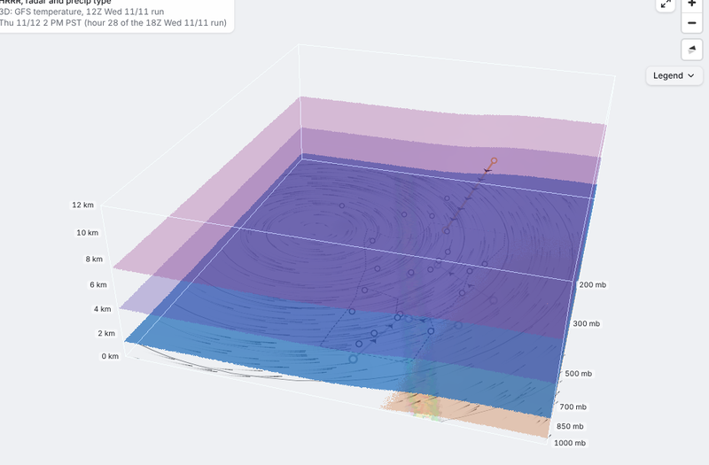

**Colour modes.** The volume and the solid can be coloured three ways (`uColorMode`):

- **Own:** the field's own colours.
- **Height:** colours from the height table.
- **Field:** by a second field, which needs its own pair of 3D textures and its own colour table,
  for example cloud coloured by temperature.

The extinction always comes from the main field: the colour field only paints it.

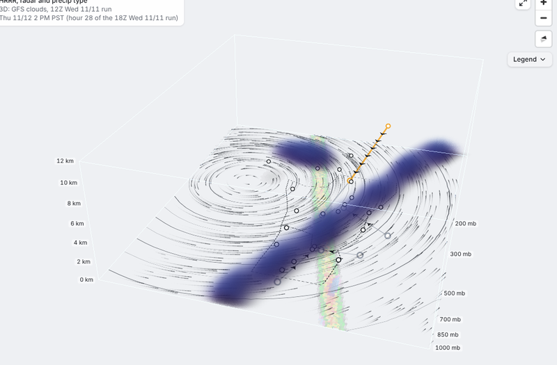

## 6. Render modes

The **Render** control in the 3D panel picks how a field draws. These all branch inside the same
shader, except Points, which is drawn separately.

| | |
|---|---|
|  **Volume.** See-through, thicker where there's more. Lit (§7) for the moisture fields; the others get a little darker low down, for depth. | 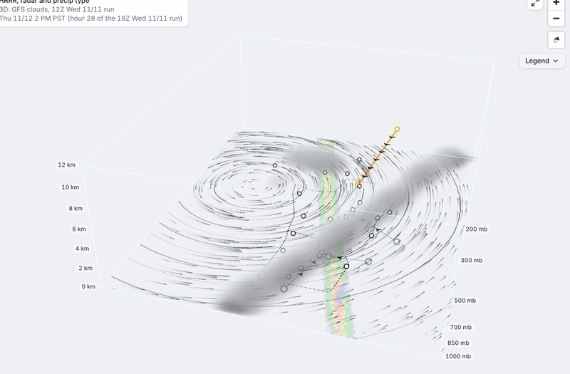 **Cloud.** The same opacity, but every sample is shaded white-grey by the light that reaches it, with a sky fill from above and forward scattering (bright edges when you look toward the light). |
| 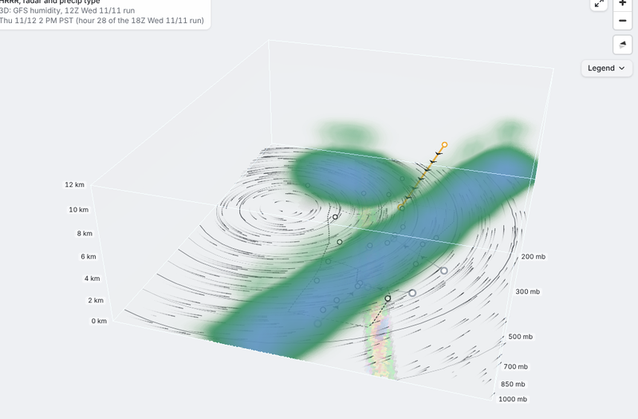 **Max.** Each ray keeps the strongest value it passes (among values the table shows at all) and draws only that, at a fixed 90% opacity. This is a maximum-intensity projection, like composite radar, and the cores show from any angle. It shows the cores but not their depth. | 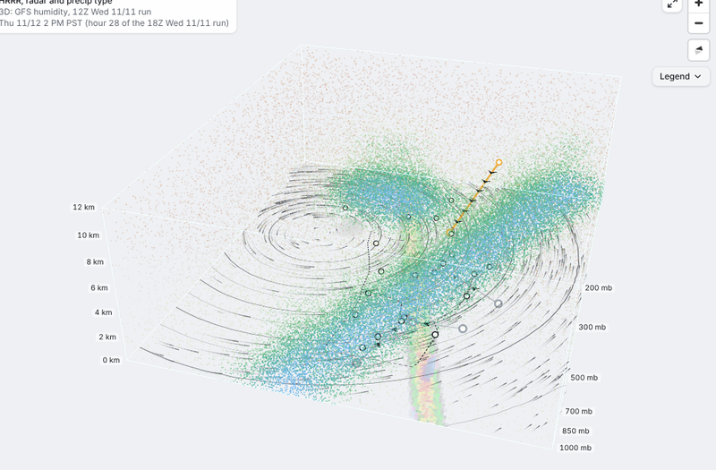 **Points.** Dots. Each cell gets dots in proportion to `1 − exp(−1.5·extinction)`, at random spots inside the cell, coloured like the volume. |
| 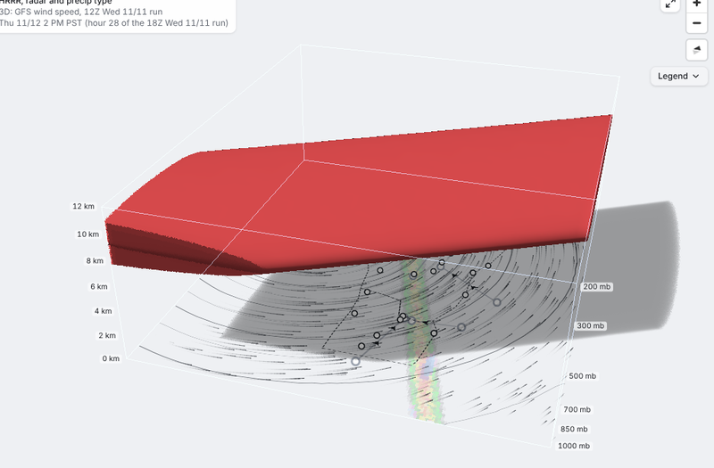 **Solid.** An opaque (or partly see-through) lit surface where the field first reaches a chosen value. The hit is refined with 6 bisection steps, the normal is the field's gradient, and the shading uses Blinn-Phong with self-shadowing. | 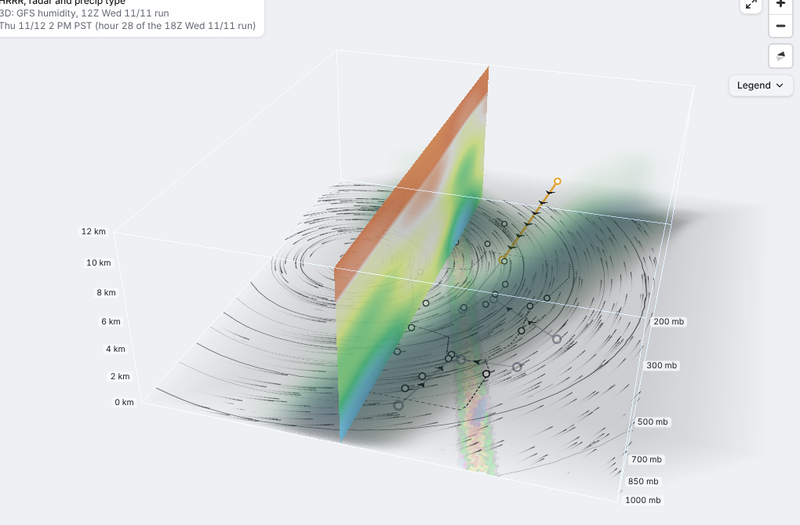 **Scan.** A slice at one height, or along one longitude or latitude (here humidity, west to east), in the field's own colours (`uPLut`), at 90% opacity. The rest of the field fades to 15% (`uRest`). The slider moves the plane, and Play sweeps it across the box in about 6 s. |

**How each mode works in the shader:**

- **Max** doesn't composite in the loop. It records `vmax` and the point where it occurred,
  steps on, and draws the result once after the loop. The point is kept so that colouring by
  height or by another field still works.
- **Solid** replaces the transfer table with a threshold test, `v ≥ uSolidAt`. On the first
  crossing it finds the surface, lights it, composites it at `uSolidAlpha` and ends the ray. The
  page zeroes the volume's own table, so only the surface draws.
- **Scan** works out where the ray meets the plane when the ray starts. When the march reaches
  that distance, it composites the plane's colour there, then carries on with the rest of the
  field faded. Plane colours come from `colorLut`, which shows *every* value: unlike the transfer
  table it has no transparent range, so you see the whole field across the slice.
- **Points** doesn't march at all (`empty: true`). `pointCloud` in `lib/volume-overlays.ts`
  builds the dots on the CPU. Each cell's dots come from a fixed hash of its index, so they keep
  their places as time moves and the motion you see is the field changing, not the dots
  reshuffling. There are at most 14 dots per cell and about 120,000 in total (× the density
  slider). They're rebuilt at most every 120 ms while the clock moves and drawn as round
  `gl.POINTS` sprites.

**Opacity and "show from".** The opacity slider scales `uDensity` (the extinction multiplier), and
for Points it scales the number of dots. "Show from" zeroes the table's alpha below a byte, which
hides the thin parts in every mode.

Temperature, wind and PV offer **Surfaces / Solid** only: their volume is a faint wash and their
surfaces are the picture.

## 7. Lighting and shadows

The light (`LW`, a uniform) is a direction in true proportions (x east, y south, z up). By
default it's a **fixed light** from the south-west, `(−0.5, 0.42, 0.76)`. The **Light** control can
switch it to **the sun at the map's time** over the middle of the box. `sunPosition` uses NOAA's
low-precision formulas, good to a few tenths of a degree, and `sunLight` turns that into the
direction, the colour (`uSunCol`) and how much sky light fills the shade (`uAmb`):

- **By day** the light is white. The light still comes from the sun's direction when it's lower,
  but its elevation is held at 8° or more, so shadows stay on the map.
- **Toward sunset** it warms and dims.
- **Through twilight into night** it becomes a dim, cool, moonlight-blue, with less sky fill, and
  ground shadows fade with it.

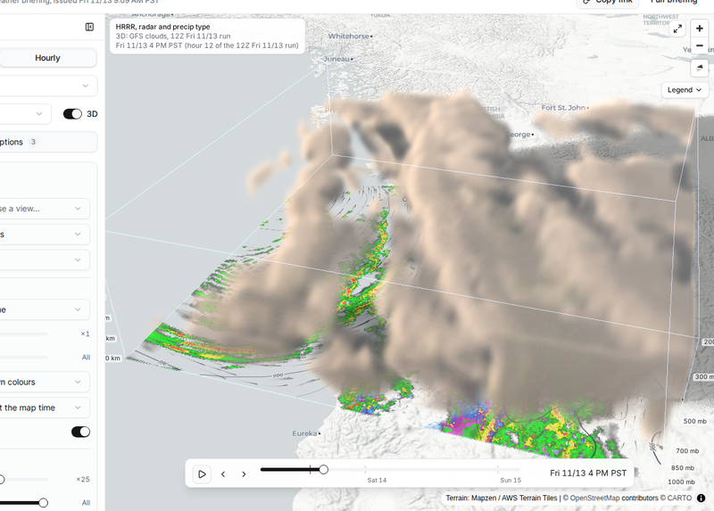

In box units the direction is rescaled to climb one box height
(`lightBox()`), which keeps the light's angle the same at any exaggeration.

**Lit volumes** (cloud, water, ice, humidity, moisture flow, snow growth zone, icing). At each
sample, `lightAt` takes 6 taps toward the light, spaced further apart further out (`d0·k²`). It
sums their extinction into an optical depth, and the light that gets through is `L = exp(−depth)`.
The colour is then:

```
colour × (0.34 ambient + 0.16 · height + 0.62 · L + 0.25 · forward · L)
```

Here `forward = max(dot(view, light), 0)⁶` brightens cloud edges when you look toward the light.
The result is the familiar look of cloud tops lit and bases grey, without a second pass.

**The solid's shading** is ambient plus sky plus diffuse (`0.36 + 0.14·up + 0.62·N·L·shadow`),
plus a small specular highlight. Its self-shadow uses the same 6 taps, but counts taps *inside*
the solid instead of extinction.

**Ground shadows.** When a ray misses the solid and the volume doesn't block it, it's continued to
the ground: the map plane, refined twice against the terrain height. From there it marches 56
dithered taps toward the light, up through the box. Their optical depth (or, for a solid, a soft
inside/outside count) darkens the ground by up to 36%, composited as black in premultiplied
alpha. Shadows only show for the solid and for lit volumes in Volume or Cloud mode, because a
shadow from a field you can't see reads as an error.

## 8. Caching and frame flow

Marching hundreds of samples per pixel, each with 6 light taps, is the costly part, so the layer
renders it into an **offscreen image** and only re-marches when something that affects it
changes.

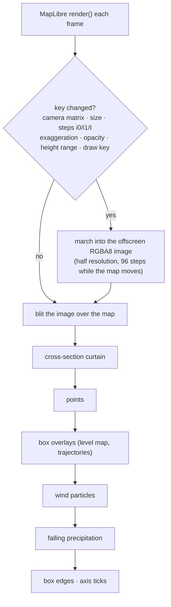

- **Re-march key.** The key covers the camera matrix (to 9 digits), the image size, the two time
  steps and the blend, the exaggeration, the opacity, the height range and the draw key. The page
  builds the draw key from the field, mode, colour, solid, scan, density and threshold. Moving
  the scan during a sweep sets a separate `dataChanged` flag (`setScanPos`), so the page doesn't
  rebuild the draw for every frame of the sweep.
- **While the map moves,** the march runs at half resolution with half the steps, which is
  barely noticeable mid-gesture. Full quality returns when the map comes to rest.
- **Frames that don't need a re-march** still redraw: wind particles and falling precipitation
  keep MapLibre repainting, and those frames just blit the cached image.
- **Uploads are cached:** 3D textures are kept per step, and the tables are only re-uploaded when
  the draw key changes.
- Each 2D table has **its own texture unit**: 2 for the transfer table, 3 for height, 4 for
  terrain, 7 for the colour field's table and 8 for the scan's. WebGL refuses to draw if a 2D and
  a 3D sampler share a unit, and units 0, 1, 5 and 6 hold the 3D textures.

## 9. Everything else in the box

All of these use the same box coordinates and the layer's MVP matrix. The CPU-side ones keep
their vertex data in `xyz + premultiplied rgba` (28-byte) buffers.

- **Wind particles:** 650 per height layer, each with a 7-point trail. They're advected through
  the model's u/v (trilinear in space, blended in time) at 160 simulated seconds per frame, fade
  in and out over their life, and respawn when they leave the box or go under the terrain. They're
  coloured by speed, or by the drawn field's value where they are (for example moisture flow).
- **Falling precipitation** (`lib/gl/precip-fx.ts`) comes from the 2D map's radar layer. Where
  the model shows precipitation, up to 14,000 drops and flakes fall from about 3.5 km, as many
  as the intensity calls for. Rain is drawn as blue streaks: instanced quads a fixed number of
  pixels wide, bright at the head and fading up the trail (WebGL lines are only a pixel wide).
  Freezing rain falls the same way in pink. Snow is drawn as wobbling soft white flakes (point
  sprites with a gaussian glow over a fainter, wider grey shadow, so they show over a light map),
  sleet as small, hard orange ice pellets, and mixes as short purple streaks.
- **Level maps** (`levelOverlay`) draw a pressure level at its mean height. They show its height
  contours, from the `hgt` departures (every 3 dam at 850 and 700 mb, 6 dam above), labelled in
  decametres, with wind arrows sampled at that height.
- **Trajectories** (`trajectories`) trace backward paths of the air arriving over each forecast
  location at 1.5 and 3 km. They're integrated with a midpoint (RK2) step every 15 minutes
  through u, v and w, for up to 24 hours, coloured by height and fading into the past.
- **The cross-section** (`lib/xsection.ts`, `CrossSection.tsx`) samples the field along a line
  for the 2D panel. The same image is drawn back into the box as a vertical **curtain** along the
  line.
- **The vertical profile** (`Profile.tsx`) reads one column (bilinear, blended in time) for a
  simple sounding: temperature and dewpoint (from the humidity) by height, and its point is marked in the box.
- **Terrain.** MapLibre's own 3D terrain (`raster-dem`, Terrarium tiles) raises the map, and the
  2D weather layer is draped over it through a canvas source (`GridDrape`). The volume layer also
  receives the terrain's heights over the box at about 0.025° (`groundFor`), stored as an R8
  texture scaled to 5 km. Rays, particles and falling precipitation stop at the mountains, and
  shadows land on them.
- **Axis ticks:** heights up the south-west edge and the models' pressure levels (at their mean
  heights) up the south-east edge. They're projected to screen positions each frame and labelled
  by the page in HTML, so the text stays sharp.

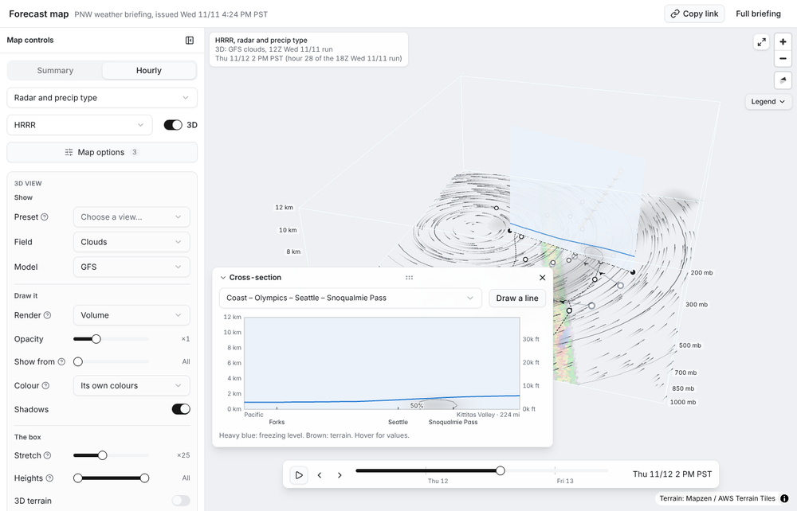

## Hover readout

With **Readout on hover** on (Tools), moving the cursor over the box shows what's under it, for
example "Clouds 68% at 9.0 km (29,600 ft) · ~300 mb", above the 2D map's own readout.
`VolumeLayer.probe` reruns the shader's ray for that pixel on the CPU, using the last inverse
matrix, the same box clip and terrain test, trilinear sampling blended in time, and the same
step opacity. It stops at the first thing that shows:

- the scan's slice;
- the solid;
- a surface (it then reports which one, or for the freezing and snow levels just the height);
- the volume, once it's about a quarter opaque;
- in Max mode, the ray's strongest value.

The height is converted to feet, and to an approximate pressure from the model's levels.

## 10. Adding a field

1. **Data** (`briefing/volume.py`): derive the variable in `derive()`, and give it a range,
   scale, units and label in `VARS`. Add the GRIB records it needs to `PATTERN`/`NAMES` if they
   aren't read yet. Add a test in `tests/test_volume.py`, and to `demo_volume` so the demo has it.
2. **View** (`lib/volume.ts`): add it to `VolVar`, `VOL_ORDER`, `SOURCE` and `VIEW_LABEL`, and give it a case in
   `transfer()` (colour and extinction) and in `colorLut`/`legendStops`. Add `ISOS` if it reads
   better as surfaces. If it's worked out from other fields, add a `DERIVED` entry instead of a
   file.
3. **Page** (`sections/InteractiveMap.tsx`): add it to `VOLUME_VIEWS` if it's a see-through
   volume, and to `LIT_VIEWS` if light should shade it. Give it `SOLID_AT` values for Solid mode,
   and add it to `COLOR_BY` if other fields should be colourable by it. Add a line to
   `volumeNotes` for the About panel.
4. **Cross-section** (`lib/xsection.ts`): add `sliceColor` and `contourLevels` cases if the
   defaults don't suit it.

## 11. Where the code lives

| File | What's in it |
|---|---|
| `briefing/volume.py` | fetching, deriving, resampling, packing, the manifest, the demo storm |
| `web/src/lib/volume.ts` | manifest and loading, unpacking, derived views, transfer and colour tables, surfaces, legend stops |
| `web/src/lib/gl/volume-layer.ts` | the custom layer: ray-march shader, textures, caching, particles, points, overlays, curtain, axis, the sun, the hover probe |
| `web/src/lib/mrms3d.ts` | observed 3D radar: frame listing, decoding the levels, packing, loading frames as the clock reaches them |
| `web/src/lib/volume-overlays.ts` | level maps, trajectories, the point cloud (CPU side) |
| `web/src/lib/gl/precip-fx.ts` | falling rain and snow |
| `web/src/lib/gl/terrain.ts` | draping the 2D layer over terrain, ground heights for the box, the snow line |
| `web/src/lib/xsection.ts`, `sections/CrossSection.tsx` | cross-section sampling, colours, contours, the panel |
| `web/src/sections/Profile.tsx` | the vertical profile |
| `web/src/sections/InteractiveMap.tsx` | the 3D panel (field, render mode, colour, box, tools, presets), URL state, and `MapPane`, which wires all of the above into the layer |
